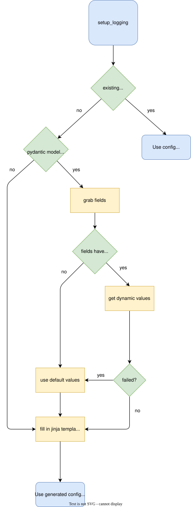

# Logging Utils Proposal

``aind-logging-util`` is a helper library used to configure logging for a python project. There are varying levels of opinionation:  

- Load directly from config file (logging.config or loguru-config) - library not necessary
- Utilize models (from JSON schemas) to create config file and load from that file
- Utilize models (from JSON schemas) with additional default factories to create config file and load from that file

Essentially a user could do the following: 

- Create their own configuration to setup logging (documentation provided to aid them) 
- Utilize ``aind-log-utils`` to create a config file to setup logging 
- Utilize ``aind-log-utils`` & models to create a config file w/ values dynamically set to setup logging

## Logging Utils Flowchart Diagram



## Schemas/Models

The sources of truth for logging schemas will be stored in this repository as JSON schemas. This gives us the following: 

- Language agnostic
- Can easily generate pydantic or c# models from JSON schemas (would be done with GitHub Actions)
- Single source of truth for users to reference
- Inheritance-like composition: can define a ``base.schema.json`` and inherit fields from it in a child schema.

### Example 

Note: this is not an actual schema, just an example.

**JSON Schema (default_log_fields.schema.json)**
```json
{
  "$schema": "https://json-schema.org/draft/2020-12/schema",
  "$id": "https://example.com/schemas/default-log-fields.json",
  "title": "DefaultLogFields",
  "description": "Base logging fields used for all logs. Provides common context for software, rig, and component.",
  "type": "object",
  "properties": {
    "software": {
      "type": ["string", "null"],
      "description": "Name of the software application",
      "examples": ["stagewidget"]
    },
    "rig_id": {
      "type": ["string", "null"],
      "description": "Rig ID",
      "examples": ["FRG"]
    },
    "comp_id": {
      "type": ["string", "null"],
      "description": "Computer ID",
      "examples": ["A"]
    },
    "instance": {
      "type": ["integer", "null"],
      "description": "Instance number",
      "examples": [1]
    },
    "hostname": {
      "type": ["string", "null"],
      "description": "Computer Host Name",
      "examples": ["DT700413"]
    }
  },
  "additionalProperties": true 
}
```

**Generated python (default_log_fields.py)**
```python
from typing import Optional
from pydantic import BaseModel, Field


class DefaultLogFields(BaseModel):
    software: Optional[str] = Field(
        default=None,
        description="Name of the software application",
        examples=["stagewidget"],
    )
    rig_id: Optional[str] = Field(
        default=None,
        description="Rig ID",
        examples=["FRG"],
    )
    comp_id: Optional[str] = Field(
        default=None,
        description="Computer ID",
        examples=["A"],
    )
    instance: Optional[int] = Field(
        default=None,
        description="Instance number",
        examples=[1],
    )
    hostname: Optional[str] = Field(
        default=None,
        description="Computer Host Name",
        examples=["DT700413"],
    )

    model_config = ConfigDict(extra='allow')  
```


**Additional User Modification for default_factories (default_log_fields.py)**
```python
from typing import Optional
from pydantic import BaseModel, Field

def field_from_env():
    try:
        full_rig_id = os.getenv("aibs_comp_id", None)
        rig_part, comp = full_rig_id.split("-", 1)
        rig, instance_str = rig_part.split(".", 1)
        instance = int(instance_str)
        return rig, comp, instance
    except Exception:
        return None, None, None

class DefaultLogFields(BaseModel):
    software: Optional[str] = Field(
        default=None,
        description="Name of the software application",
        examples=["stagewidget"],
    )
    rig_id: Optional[str] = Field(
        default_factory=lambda: field_from_env()[0],
        description="Rig ID",
        examples=["FRG"],
    )
    comp_id: Optional[str] = Field(
        default_factory=lambda: field_from_env()[1],
        description="Computer ID",
        examples=["A"],
    )
    instance: Optional[int] = Field(
        default_factory=lambda: field_from_env()[2],
        description="Instance number",
        examples=[1],
    )
    hostname: Optional[str] = Field(
        default=None,
        description="Computer Host Name",
        examples=["DT700413"],
    )

    model_config = ConfigDict(extra='allow')  
```


## Templates

Jinja templates are used to generate config files that can be used to setup logging. 

Why not configure logging directly with helper library? Using configuration files to setup logging would align with users who don't want to use the ``aind-log-utils`` library and want to setup logging with config files only. Both can be supported if necessary.

### Example 

```jinja
version: 1
disable_existing_loggers: false

formatters:
  logfile_format:
    "()": "main.JSONFormatter"

    {{ name }}: {{ value }}


handlers:
  file:
    class: logging.FileHandler
    level: DEBUG
    formatter: logfile_format
    filename: "app_logs.json"

root:
  level: INFO
  handlers: [file]
```

## Project Structure 

```
libraries/
├── python/
│   ├── aind_log_util/
│   │   ├── templates/
│   │   └── ...
│   └── models/               <- auto-generated from schemas
│       ├── sipe_rigs.py
│       ├── codeocean.py
│       └── sci_comp.py  
└── csharp/
    ├── aind_log_util/
    │   ├── templates/
    │   └── ...       
    └── models/               <- auto-generated from schemas
        ├── sipe_rigs.cs
        ├── codeocean.cs
        └── sci_comp.cs

schemas/
├── sipe_rigs.schema.json
├── codeocean.schemas.json
└── sci_comp.schema.json

docs/
└── best-practices.md
```


